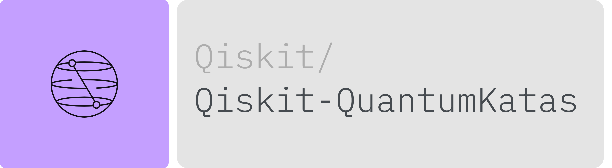

# Qiskit QuantumKatas

A benchmark dataset for evaluating Large Language Models on quantum computing code generation tasks using Qiskit.

## Dataset Description

This dataset contains **350 quantum computing tasks** translated from Microsoft's [QuantumKatas](https://github.com/microsoft/QuantumKatas) (originally in Q#) to Qiskit (Python). It is designed for evaluating LLMs on their ability to generate correct quantum computing code.

### Supported Tasks

- **Code Generation**: Given a natural language description and function signature, generate correct Qiskit code
- **Quantum Algorithm Implementation**: Implement various quantum algorithms and protocols

## Dataset Structure

### Data Fields

| Field | Type | Description |
|-------|------|-------------|
| `task_id` | string | Unique identifier in format `Category/Number.SubNumber` |
| `prompt` | string | Natural language task description with function signature |
| `canonical_solution` | string | Reference implementation in Qiskit |
| `test` | string | Unit tests using Qiskit's Statevector simulator |
| `entry_point` | string | Name of the function to implement |

### Data Splits

| Split | Examples |
|-------|----------|
| test | 350 |

### Categories

The dataset covers 26 categories of quantum computing tasks:

| Category | Tasks | Description |
|----------|-------|-------------|
| BasicGates | 16 | Fundamental quantum gates (X, Y, Z, H, CNOT) |
| Superposition | 21 | Superposition state preparation |
| Measurements | 18 | Quantum measurements and state discrimination |
| DeutschJozsa | 15 | Deutsch-Jozsa algorithm implementation |
| GroversAlgorithm | 8 | Grover's search algorithm |
| QFT | 16 | Quantum Fourier Transform |
| PhaseEstimation | 7 | Quantum Phase Estimation |
| Teleportation | 14 | Quantum teleportation protocols |
| RippleCarryAdder | 23 | Quantum arithmetic circuits |
| GraphColoring | 17 | Graph coloring oracles |
| BoundedKnapsack | 17 | Bounded knapsack oracles |
| UnitaryPatterns | 18 | Unitary matrix pattern implementation |
| DistinguishUnitaries | 15 | Distinguishing quantum operations |
| JointMeasurements | 13 | Multi-qubit measurements |
| QEC_BitFlipCode | 12 | Quantum error correction |
| MagicSquareGame | 12 | Magic square quantum game |
| MarkingOracles | 11 | Marking oracle construction |
| SolveSATWithGrover | 10 | SAT solving with Grover's algorithm |
| KeyDistribution_BB84 | 10 | BB84 quantum key distribution |
| TruthTables | 10 | Truth table oracle implementation |
| CHSHGame | 8 | CHSH quantum game |
| SimonsAlgorithm | 7 | Simon's algorithm |
| GHZGame | 7 | GHZ quantum game |
| SuperdenseCoding | 5 | Superdense coding protocol |
| tutorials | 32 | Tutorial exercises |
| examples | 8 | Example problems |

## Usage

### Loading the Dataset

```python
from datasets import load_dataset

dataset = load_dataset("Qiskit/qiskit-quantumkatas")
```

### Example Task

```python
task = dataset["test"][0]
print(f"Task ID: {task['task_id']}")
print(f"Entry Point: {task['entry_point']}")
print(f"Prompt:\n{task['prompt']}")
```

### Evaluation

To evaluate model-generated code:

```python
def evaluate_solution(task, generated_code):
    """Execute generated code and run tests."""
    import numpy as np
    from qiskit import QuantumCircuit
    from qiskit.quantum_info import Statevector
    from qiskit_aer import AerSimulator

    # Combine generated code with test code
    full_code = generated_code + "\n\n" + task["test"]
    full_code += f"\n\ntest_{task['entry_point']}()"

    try:
        exec(full_code, {
            "__builtins__": __builtins__,
            "np": np,
            "numpy": np,
            "QuantumCircuit": QuantumCircuit,
            "Statevector": Statevector,
            "AerSimulator": AerSimulator,
        })
        return True  # All tests passed
    except Exception as e:
        return False  # Test failed
```

For comprehensive evaluation, use the [benchmark framework](https://github.com/qiskit-community/Qiskit-QuantumKatas).

## Requirements

Generated solutions must be compatible with:
- Python 3.10+
- Qiskit >= 2.0.0
- Qiskit-Aer >= 0.15.0

## Citation

If you use this dataset, please cite:

```bibtex
@misc{qiskit-quantum-katas,
  title={Qiskit QuantumKatas: Adapting Microsoft's Quantum Computing Exercises for LLM Evaluation},
  author={Cruz-Benito, Juan and Faro, Ismael},
  year={2026},
  howpublished={\url{https://huggingface.co/datasets/Qiskit/qiskit-quantumkatas}}
}
```

## Source

This dataset is derived from Microsoft's [QuantumKatas](https://github.com/microsoft/QuantumKatas), translated from Q# to Qiskit Python.

## License

This work is licensed under the [Creative Commons Attribution-NonCommercial-ShareAlike 4.0 International License (CC-BY-NC-SA-4.0)](https://creativecommons.org/licenses/by-nc-sa/4.0/).
